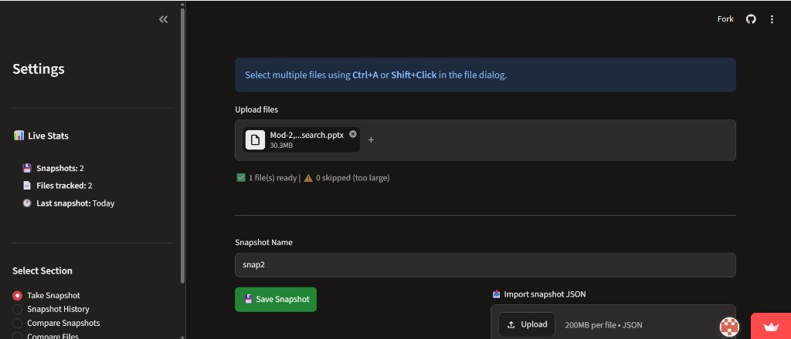
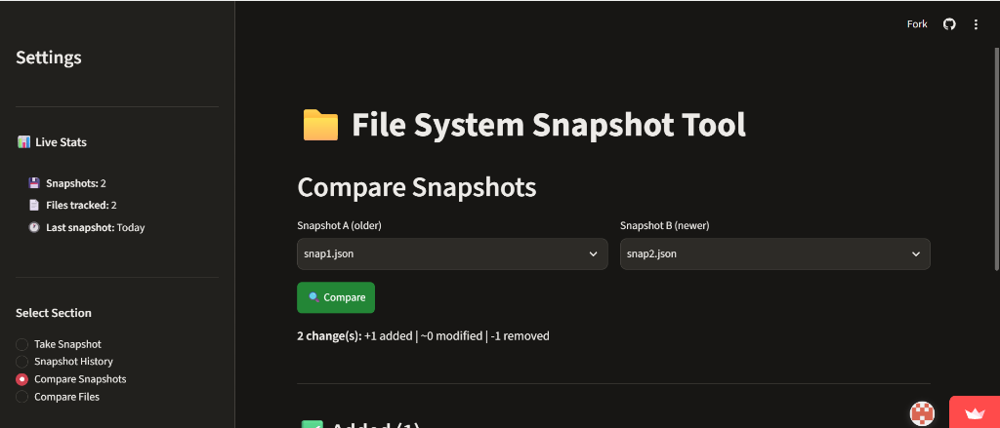
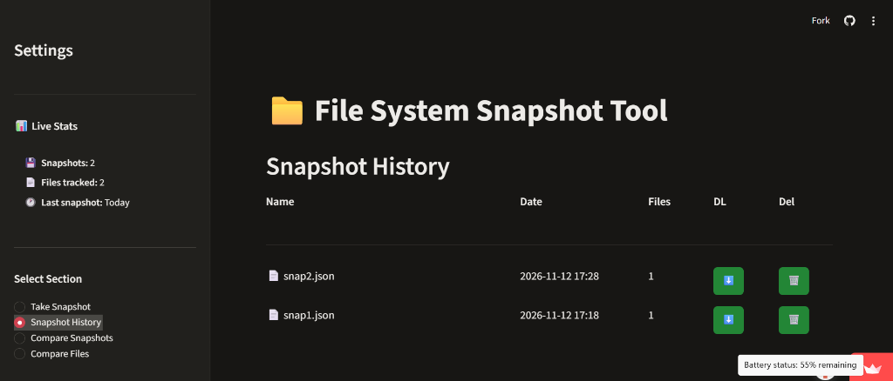

# 📁 File System Snapshot Difference

[](https://www.python.org/)
[](https://streamlit.io/)
[](LICENSE)
[](https://snapshot-difference-kgankzlgova2faayonisbx.streamlit.app)

A Python-based developer tool that captures snapshots of uploaded files and compares them to detect **added, modified, and removed files**. It features a clean **Streamlit web UI** supporting both individual file uploads and full ZIP folder uploads.

This project was developed as part of an **On-the-Job Training (OJT)** program to understand file system behavior, content-based cryptographic hashing, and practical UI integration using Streamlit.

🚀 **Live Application:** [snapshot-difference-kgankzlgova2faayonisbx.streamlit.app](https://snapshot-difference-kgankzlgova2faayonisbx.streamlit.app)

---

## 🚀 Features

### 1. File Snapshot Generation
- Upload individual files or an entire folder as a `.zip` archive.
- Generates file metadata (**relative file path + MD5 checksum**) and saves it as a structured JSON snapshot.
- Memory-efficient processing: reads files in 8KB chunks and handles files up to 50MB.
- Download snapshots as JSON for permanent offline storage.
- Import previously exported snapshot JSON files back into the application.



---

### 2. Snapshot Comparison (Diff Tool)
Compares any two snapshots (**Snapshot A** vs **Snapshot B**) to detect:
- 🟢 **Added Files:** Present in Snapshot B but missing in Snapshot A.
- 🟡 **Modified Files:** File content changed (detected via MD5 hash mismatch).
- 🔴 **Removed Files:** Present in Snapshot A but missing in Snapshot B.
- 📝 **Line-by-Line Diff:** For text files, provides an inline diff showing exact line additions and deletions. For binaries, shows byte-size differences.



---

### 3. Snapshot History Table
Displays all saved snapshots in a structured overview:
- **Snapshot Name**
- **Date & Time** of creation
- **Total files** tracked
- **Download button (⬇️):** Save snapshot JSON locally
- **Delete button (🗑️):** Remove snapshot from disk



---

### 4. Live Stats in Sidebar
Real-time dashboard metrics that update automatically on every save, import, or delete:
- 💾 **Total snapshots saved**
- 📄 **Total files tracked**
- 🕐 **Last snapshot date**

---

### 5. Compare Files Directly
Quickly compare two versions of an individual file without saving snapshots:
- Check whether files are identical (`NO CHANGE`) or changed (`MODIFIED`).
- View side-by-side file size and MD5 hash comparison.
- View line-by-line diff for plain text files.

---

## 🧭 How to Use the Streamlit UI

### Step 1: Take a Snapshot
1. Go to the **Take Snapshot** section.
2. Choose upload mode: **Individual Files** or **ZIP Folder**.
3. Upload your files and enter a snapshot name (e.g., `snap1`).
4. Click **💾 Save Snapshot**.

### Step 2: Compare Snapshots
1. Go to the **Compare Snapshots** section.
2. Select **Snapshot A (older)** and **Snapshot B (newer)**.
3. Click **🔍 Compare**.
4. Review the change breakdown: Added, Modified (with line diff), and Removed files.

### Step 3: Compare Files Directly
1. Go to the **Compare Files** section.
2. Upload the **Old File** and **New File**.
3. Click **🔍 Compare Files** to view status, MD5 hashes, size delta, and text diff.

### Step 4: Manage Snapshots
1. Go to the **Snapshot History** section.
2. Download snapshots as JSON (⬇️) for permanent offline records.
3. Delete snapshots (🗑️) when no longer needed.
4. Import previously downloaded snapshots via the import box in the Take Snapshot section.

---

## 📌 Example Output

### Snapshot Diff
```text
2 change(s): +1 added | ~0 modified | -1 removed
```

- **🟢 Added Files**
  - `Mod-2_Search_Techniques.pptx`
- **🔴 Removed Files**
  - `Mod-1_Business_Analysis.pptx`

### Text Line-by-Line Diff
```diff
- line 1: old database connection
+ line 1: updated database connection
  line 2: unchanged config setting
+ line 3: added new environment variable
```

---

## 🗂️ Project Structure

```text
FILE-SYSTEM-SNAPSHOT-DIFFERENCE/
│
├── assets/                 # UI screenshots for documentation
│   ├── take_snapshot.png
│   ├── compare_snapshots.png
│   └── snapshot_history.png
│
├── folder/                 # Sample folder for testing
│   └── text.txt
│
├── snapshots/              # Saved snapshot JSON files
│   └── .gitkeep
│
├── src/
│   ├── diff.py             # Snapshot comparison and line diff logic
│   ├── file_compare.py     # Single file comparison logic
│   ├── main.py             # CLI text-based menu interface
│   ├── snapshot.py         # Directory traversal & MD5 hashing
│   └── __init__.py
│
├── .streamlit/
│   └── config.toml         # Streamlit theme and server configuration
├── app.py                  # Streamlit web UI entry point
├── requirements.txt        # Project dependencies
├── LICENSE                 # MIT License
└── README.md               # Project documentation
```

---

## 🛠️ Tech Stack

| Technology | Role |
| :--- | :--- |
| **Python 3** | Core language and logic |
| **Streamlit** | Interactive browser-based web UI |
| **Hashlib (MD5)** | Cryptographic checksum generation (read in 8KB chunks) |
| **Difflib** | Line-by-line sequence matching for text files |
| **Zipfile** | In-memory archive extraction |
| **JSON & OS** | Metadata persistence and filesystem operations |

---

## ▶️ How to Run the Project Locally

### 1. Clone the Repository
```bash
git clone https://github.com/famyali786-hash/Snap-shot-diff.git
cd Snap-shot-diff
```

### 2. Install Dependencies
```bash
pip install -r requirements.txt
```

### 3. Run the Streamlit App
```bash
streamlit run app.py
```

### 4. (Optional) Run the CLI Menu
```bash
python src/main.py
```

---

## 🎯 Purpose of the Project

This OJT project was designed to understand:
- How file systems store, index, and organize file metadata.
- Why cryptographic content hashing (MD5) is superior to timestamps for change detection.
- How to design real-world developer tools with modular backend logic (`src/`).
- How to build and deploy clean, state-driven interfaces with Streamlit.
- Scalable code structuring with CLI and Web UI co-existing.

---

## 🌱 Future Improvements

- [ ] Snapshot version tagging (e.g. `v1.0.0`, `staging`, `prod`)
- [ ] Export diff reports as downloadable PDF or CSV
- [ ] Search and filter controls for large snapshot libraries
- [ ] Support for custom ignore rules (e.g., skip `.pyc`, `.git`, `node_modules`)

---

## 📄 License

This project is licensed under the MIT License - see the [LICENSE](LICENSE) file for details.
